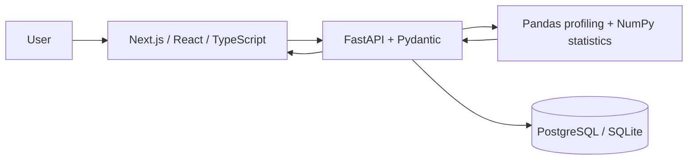
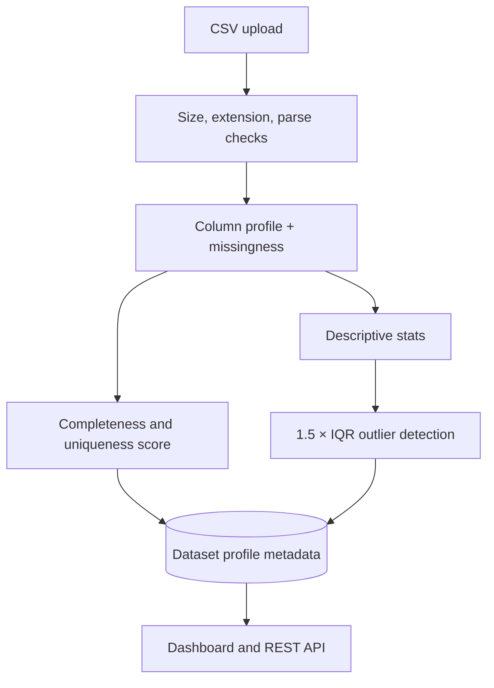
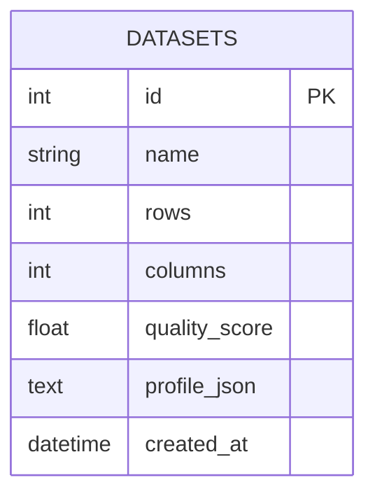

# DataSentinel — Data Observability & Quality Intelligence

> Open-source workspace for profiling datasets, scoring quality, and finding statistical outliers.

  

## Problem and value proposition
Bad source data quietly compromises reporting and ML. DataSentinel gives teams a lightweight local-first workflow to ingest CSVs, compute interpretable quality metrics, inspect column profiles, and review IQR outlier groups—without paid AI APIs.

## Features
- CSV upload (15 MB, 500k-row limits), parsing validation
- Completeness + uniqueness composite score
- Column type, missingness and cardinality profile
- Numeric descriptive statistics and 1.5×IQR outlier groups
- Dataset registry, details, deletion and overview REST endpoints
- Responsive Next.js dashboard
- PostgreSQL via SQLAlchemy; SQLite default for local backend quickstart
- Docker Compose environment and health endpoint

## Architecture

## Data pipeline

## Database ER

## Quickstart: local
Backend:
```bash
cd backend
python -m venv .venv
source .venv/bin/activate  # Windows: .venv\\Scripts\\activate
pip install -r requirements.txt
uvicorn app.main:app --reload
```
Frontend (second terminal):
```bash
cd frontend
npm install
npm run dev
```
Visit http://localhost:3000. Backend API docs: http://localhost:8000/docs. The backend defaults to local SQLite.
## Docker Compose
```bash
cp .env.example .env
# Edit POSTGRES_PASSWORD
docker compose up --build
```
## API
- `GET /health` — service health
- `GET /api/datasets` — profiles registry
- `POST /api/datasets/upload` — multipart CSV ingestion
- `GET /api/datasets/{id}` — profile
- `DELETE /api/datasets/{id}` — remove profile
- `GET /api/analytics/overview` — aggregate registry metrics
Interactive OpenAPI docs are at `/docs`.
## Tests
```bash
cd backend && pytest
```
The current test suite covers health. Expand with upload/profile persistence and DB integration tests before production use.
## Security notes
This MVP is not production-ready authentication software. It currently has no user identity or tenant isolation. Keep it private/local; add authentication, authorization, rate limits, audit logging, secret management, malware/file scanning, and strict per-tenant storage before deployment. Uploaded file contents are processed in memory and only profile metadata is persisted.
## Roadmap
- [ ] JWT/OIDC auth, tenant and dataset permissions
- [ ] Alembic migrations
- [ ] Persist raw dataset versions / object storage
- [ ] Rule editor and configurable score weights
- [ ] Time-series data drift and PSI/KS tests
- [ ] Model-based anomaly detection with evaluation reports
- [ ] Plotly interactive charts and exports
- [ ] Scheduled monitors, alerts and webhook integrations
- [ ] React Native Expo mobile client
## License
MIT. See LICENSE.
